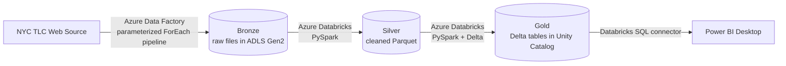
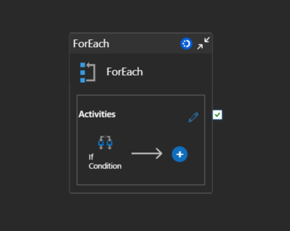
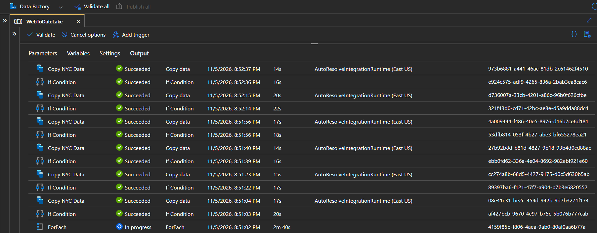

# NYC Taxi Data Engineering Pipeline

An end-to-end batch data pipeline on Azure that ingests NYC green taxi trip data for 2025, transforms it through a **medallion architecture** (bronze, silver, gold) with PySpark, stores curated data as **Delta tables in Unity Catalog**, and serves it to **Power BI**.

## Architecture



## Tech Stack

| Layer | Technology |
|---|---|
| Orchestration and ingestion | Azure Data Factory (parameterized pipeline, ForEach, If Condition, scheduled trigger) |
| Storage | Azure Data Lake Storage Gen2 (`bronze`, `silver`, `gold` containers) |
| Processing | Azure Databricks, PySpark |
| Table format and governance | Delta Lake, Unity Catalog |
| Reporting | Power BI Desktop (via Databricks SQL) |

## Data Source

- **Trip data:** NYC Taxi and Limousine Commission (TLC) green taxi trip records for 2025, one Parquet file per month (12 files).
- **Zone lookup:** TLC taxi zone lookup CSV (`LocationID`, `Borough`, `Zone`, `service_zone`).
- Source: [NYC TLC Trip Record Data](https://www.nyc.gov/site/tlc/about/tlc-trip-record-data.page)

## Pipeline Walkthrough

### 1. Ingestion (Azure Data Factory)

The `WebToDateLake` pipeline is **parameterized** so that a single pipeline handles all 12 monthly files instead of 12 separate copy activities. A **ForEach** activity loops over the list of files, and an **If Condition** activity controls the copy logic inside the loop. Files land in the `bronze` container of the storage account. A **scheduled trigger** runs the pipeline automatically.

### 2. Bronze to Silver (`silver_notebook.py`)

- Reads the zone lookup CSV and the trip Parquet files from bronze using an **explicit schema** (21 columns, including `lpep_pickup_datetime`, `PULocationID`, `DOLocationID`, `fare_amount`, `total_amount`).
- Splits the `Zone` column into `Zone1` and `Zone2` on the `/` separator and trims whitespace.
- Derives date attributes from the pickup timestamp (`trip_date`, `trip_year`, `trip_month`, `trip_day`).
- Selects the required trip columns and writes Parquet to the `silver` container.

### 3. Silver to Gold (`gold_notebook.py`)

- Creates the Unity Catalog catalog `nyc_catalog` with managed storage in the `gold` container, and the schema `nyc_catalog.gold`.
- Writes two Delta tables:
  - `nyc_catalog.gold.trip_zone`
  - `nyc_catalog.gold.trip_2025_data`

### 4. Reporting (Power BI)

Power BI Desktop connects to the gold tables through the Azure Databricks connector, so the Delta tables can be queried and modeled for reporting.

## Repository Structure

```
.
├── databricks/
│   ├── silver_notebook.py    # Bronze -> Silver transformations
│   └── gold_notebook.py      # Silver -> Gold Delta tables in Unity Catalog
├── images/                   # Screenshots (pipeline, data fetching)
├── taxi_zone_lookup.csv      # TLC taxi zone lookup
└── README.md
```

## How to Run

1. **Azure setup:** create a resource group with a storage account (ADLS Gen2, hierarchical namespace on) containing `bronze`, `silver`, and `gold` containers, an Azure Data Factory, and an Azure Databricks workspace with an access connector.
2. **Unity Catalog:** grant the access connector access to the storage account and create an external location for the `gold` container.
3. **ADF:** build the parameterized pipeline to copy the 12 monthly files and the zone CSV into `bronze`, then publish it and add a schedule trigger.
4. **Databricks:** import the notebooks, update the storage account name in the path variables, and run `silver_notebook` followed by `gold_notebook`.
5. **Power BI:** use **Get Data > Azure Databricks**, enter the workspace server hostname and SQL warehouse HTTP path, and authenticate with OAuth or a personal access token.

> Never commit access tokens, storage keys, or connection strings to the repository.

## Screenshots





## Possible Improvements

- Keep the date, distance, tip, and payment columns in the silver layer to enable time-based analysis.
- Join trips to zones in gold (pickup and dropoff) and model a star schema with a trip fact table and a zone dimension.
- Switch the silver write mode from `append` to `overwrite` or an idempotent merge so re-runs do not duplicate data.
- Chain the Databricks notebooks into the ADF pipeline or a Databricks Job for fully automated bronze-to-gold runs.
- Add aggregated gold tables (daily revenue, trips by zone, average fare by hour).
- Replace personal access tokens with Microsoft Entra ID (OAuth) authentication.

## Author

**Om Naik**
